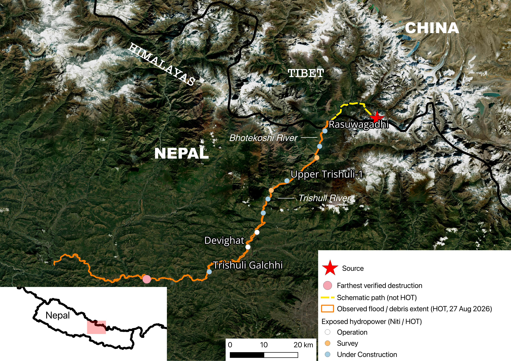

# Event Reconstruction & Hazard Chain

*Full bibliography: [`../data/sources.md`](../data/sources.md). Uncertainty framework and
status-tag definitions: [`../METHODOLOGY.md`](../METHODOLOGY.md).*

## 1. Chronological timeline

Status legend: **CONFIRMED** = corroborated by an official/technical source (USGS, ICIMOD, Nepal
NDRRMA/Police) or by multiple independent reputable sources converging on the same account.
**HYPOTHESIS** = plausible mechanism still under investigation, not yet confirmed. **REPORTED** =
figures reported by official sources but explicitly provisional/still being reconciled across
agencies. See [`../METHODOLOGY.md`](../METHODOLOGY.md) for the full uncertainty framework,
including the epistemic/aleatory distinction used in §3 below.

| Time (local, 26 Aug 2026 unless noted) | Event | Status | Source |
|---|---|---|---|
| 08:37 NPT | Large, rapid slope failure near the Nepal–China border. Peak not resolved: USGS places it near Langtang Lirung (~5,200–5,400 m). Adhikari, Subedi et al. (Seismica, 2 Oct 2026) place a rock fall with some ice, ~100 million m³, on the north flank of Tsangbu Ri (6,781 m), near Langtang Lirung; relocated source 28.298°N, 85.566°E | CONFIRMED (failure at this time) / REPORTED (peak, flank, volume) | [USGS event page — M5.2 Landslide, 55 km NW of Kodari, Nepal](https://earthquake.usgs.gov/earthquakes/eventpage/us7000tbwb); [Adhikari, Subedi et al. 2026, Seismica](https://doi.org/10.26443/seismica.v5i2.3433) |
| T+0 to T+~40 min | Debris (ice, rock, sediment) enters the Lhende Khola drainage and moves downstream via Bhote Koshi into the Trishuli River system | CONFIRMED (pathway) / HYPOTHESIS (dam formation en route — see §3) | [ICIMOD press release](https://www.icimod.org/press-release/major-flash-flood-sweeps-through-nepals-rasuwa-district-raising-fears-of-further-downstream-flooding/) |
| ~T+30 min | Trishuli River, Galchhi gauge: water level rises ~9 m in ~30 minutes | CONFIRMED | [ICIMOD press release](https://www.icimod.org/press-release/major-flash-flood-sweeps-through-nepals-rasuwa-district-raising-fears-of-further-downstream-flooding/) |
| ~T+30 min | Trishuli River, Malekhu gauge: water level rises ~7 m in a similar window | CONFIRMED | [ICIMOD press release](https://www.icimod.org/press-release/major-flash-flood-sweeps-through-nepals-rasuwa-district-raising-fears-of-further-downstream-flooding/) |
| ~T+40 min | Flood/debris wave reaches the Rasuwagadhi border crossing and downstream corridor settlements | CONFIRMED | [USGS Landslide Response page](https://www.usgs.gov/programs/landslide-hazards/science/2026-nepal-debris-avalanche-and-flash-flood) |
|27 Aug 2026 (grading product) | Syabrubesi (AOI01 Syapru Besi): >240 buildings destroyed, 32 damaged (from Copernicus EMSR927 Grading product v1). Additional context: 433 of 559 buildings affected in the AOI; ~111 ha mass movement delineated. | CONFIRMED (grading product counts)|[Copernicus EMS EMSR927 Grading products](https://mapping.emergency.copernicus.eu/activations/EMSR927/), 27 Aug 2026 (also available via HDX / IHP-WINS mirrors) |
| T+40 min onward | Corridor infrastructure impact: border crossing, roads, bridges, settlements, hydropower facilities along the Bhote Koshi–Trishuli corridor | CONFIRMED (occurrence) / illustrative in this project for depth/extent (see [`../02_exposure_vulnerability/`](../02_exposure_vulnerability/)) | [2026 Nepal–Tibet floods — Wikipedia](https://en.wikipedia.org/wiki/2026_Nepal%E2%80%93Tibet_floods) (aggregator; see article references for primary sources) |
| ~11:46 NPT | Second seismic signal, M4.2, also attributed to slope instability. USGS's event page for this signal (event ID us7000tc90) lists a precise origin time of 06:00:35 UTC, which converts to ~11:46 NPT (UTC+5:45) | CONFIRMED | [USGS event page, second signal (us7000tc90)](https://earthquake.usgs.gov/earthquakes/eventpage/us7000tc90/executive) |
| 4 Sept 2026 | Two workers — Sanjay Sah/Shah (mechanical foreman) and Kabir Maharjan (mechanical supervisor) — rescued alive from the main tunnel at the Trishuli 3A hydropower construction site, nine days after the flood | CONFIRMED | [Al Jazeera, 4 Sept 2026](https://www.aljazeera.com/news/2026/9/4/nepal-search-teams-rescue-two-workers-from-hydropower-tunnel) |
| 5 Sept 2026 | A Chinese national (Lu Haitao) rescued from a hydropower tunnel after being trapped for 10 days, reported by CNN as the Upper Trishuli-1 project. **Note:** one other outlet's photo caption attributes this rescue to Trishuli-3A instead. OCHA Sitrep No. 7 (covering 4–7 September) also places this rescue at the Upper Trishuli-1 tunnel. The 4 September Trishuli 3A worker rescue is a different row and is unchanged. | CONFIRMED (occurrence); site reported as Upper Trishuli-1 by CNN and OCHA, with one conflicting caption for Trishuli-3A | [CNN, 5 Sept 2026](https://www.cnn.com/2026/09/05/world/live-news/nepal-china-flood); [OCHA Sitrep No. 7](https://reliefweb.int/report/nepal/nepal-rasuwa-flood-situation-report-no-7-8-september-2026) |
| 5 Sept 2026 | Chandika Kumari Shrestha (64), a resident of Betrawati (Bidur Municipality-10, Nuwakot district), rescued alive from the upper floor of her collapsed four-storey home, 10 days after the flood | CONFIRMED | [Kathmandu Post, 5 Sept 2026](https://kathmandupost.com/national/2026/09/05/woman-rescued-alive-after-10-days-trapped-in-debris-buried-house) |

**Building damage note:** Building damage figures for Syabrubesi are taken from the Copernicus EMSR927 Grading product (27 Aug 2026). The activation description’s “reportedly a GLOF” language is not treated as the mechanism; the source is the high-altitude rock/ice slope failure documented above.

**Source peak — two names, not one location.** Langtang Lirung and Tsangbu Ri are
different peaks. They stand about 4 km apart in the Langtang Himal. Langtang Lirung is
the higher one, at 7,234 m (28.258°N, 85.516°E). Tsangbu Ri, also called Kimshung, is
6,781 m (28.272°N, 85.552°E). The China border is about 2 km north of Tsangbu Ri. From
the south, the two summits sit side by side.

Three sources are on record. Two place the failure at or near Langtang Lirung. One
places it on Tsangbu Ri. They have not been reconciled.

- The [USGS event page (us7000tbwb)](https://earthquake.usgs.gov/earthquakes/eventpage/us7000tbwb) calls the signal a landslide and places it near Langtang Lirung. It does not say which flank failed, or at what elevation. A 14 September 2026 [EarthArXiv preprint](https://doi.org/10.31223/X5WB9B), not peer-reviewed, says the failure was on the northern flank of Langtang Lirung.
- [Adhikari, Subedi et al., *Seismica*, 2 October 2026](https://doi.org/10.26443/seismica.v5i2.3433) say a rock fall with some ice, about 100 million m³, came off the north flank of Tsangbu Ri. When the paper says Tsangbu Ri is near Langtang Lirung, it is locating Tsangbu Ri. It is not saying the two names are the same peak. Their seismic point is 28.298°N, 85.566°E. They say it lies within about 5 km of the scarp on post-event satellite images. A scarp is the fresh cliff left where the rock broke away. The seismic point and the scarp check each other. They do not decide which summit failed.

The volume, the ice content, and the Tsangbu Ri flank are reported only by Adhikari,
Subedi et al. The northern flank of Langtang Lirung is reported only by the preprint.
Neither is a shared finding.

All three sources describe a large, rapid slope failure at 08:37 NPT on 26 August 2026,
in this border area, feeding the Lhende Khola and the Bhote Koshi. Which of the two peaks
failed does not change the path downstream.
*(**CONFIRMED**: a slope failure at 08:37 NPT produced the seismic signal. **REPORTED**:
peak, flank, elevation, ice content, and volume. The accounts are not reconciled.
See [`../METHODOLOGY.md`](../METHODOLOGY.md).)*

**Reference point — comparable prior event:** the same general corridor experienced a comparable-scale
flood 14 months earlier: the July 2025 Rasuwagadhi glacial lake outburst flood, sourced from the
Tibet side. This event's failure point is assessed as being on the Nepal side.
*(CONFIRMED as a distinct prior event — [Reuters, 10 July 2025](https://www.reuters.com/sustainability/climate-energy/tibetan-glacial-lake-drainage-triggered-deadly-flood-nepal-climate-body-says-2025-07-10/); the significance of "two major events in 14 months" for return-period assumptions is a framing question raised in [`../04_scenarios/stress_test_table.py`](../04_scenarios/stress_test_table.py), not a statistical claim.)*

---

## 2. Casualty and rescue status — dated snapshot

> **⚠ Data as of ~5 September 2026 — provisional and subject to revision.**
> Multiple agencies (Nepal Police, NDRRMA, Tibet regional authorities) were still reconciling
> figures at time of writing. Do not treat these as final. Any use of these figures in the report
> or slides should carry this same date stamp and link back to the source below.

**Nepal side** (source: [Kathmandu Post, "Nepal flood death toll reaches 1,342," published and
updated 5 Sept 2026, 11:12 NPT](https://kathmandupost.com/national/2026/09/05/nepal-flood-death-toll-reaches-1-342)):

| Metric | Value |
|---|---|
| Deaths recorded (as of 8am, 5 Sept 2026) | 1,342 |
| Still reported missing | 4,886 |
| Bodies formally identified and buried | 1,030 |

Later NDRRMA snapshots, not revisions of the ~5 September row:

- 3 September 2026, 19:00 (OCHA Sitrep No. 6): 1,259 dead, 5,083 out of contact, 12,038 rescued.
- UNFPA, covering 28 August–3 September: 1,204 dead, ~4,216 unaccounted. Different extract from the NDRRMA 19:00 figure the same day. Not averaged.
- 7 September 2026, 19:00 (OCHA Sitrep No. 7): 1,356 dead, 4,894 missing, 13,396 rescued.

Deaths rose and the missing count fell. Treat as recovery of bodies, not a corrected event size. Do not average the two rows.

Access (both sitreps): damaged roads and collapsed bridges left parts of upper Rasuwa reachable only on foot; by 4–7 September helicopters were still the only access for some communities. Same corridor assets that were damaged also blocked relief. 

Displacement was still moving. Sitrep No. 6: 3,844 people in 34 sites. Sitrep No. 7: 3,629 people in 37 sites. Schools in use as shelters rose from 8 to 25; damaged-school counts from at least 20 to at least 23, and No. 7 says assessments were ongoing. Not a final inventory.

Fiscal note, not an insurance payment: Flash Appeal US$49.6 million for 84,270 people through 31 December 2026, across Rasuwa, Nuwakot, Dhading, Chitwan, Gorkha and Tanahu. CERF (UN Central Emergency Response Fund) US$2.5 million for the initial response. Both sitreps say the appeal is not recovery or reconstruction; that waits on a Post-Disaster Needs Assessment, which these reports do not contain.

> Note: the previous version of this table also carried figures for total rescued (13,098) and
> hydropower workers reported missing (~900, of whom ~500 believed trapped in tunnels). Those
> figures do **not** appear in this specific dated article and have been removed pending
> re-sourcing from a specific, dated primary source — re-add only once verified against an
> article with the same rigor applied here.


**Tibet side** (source: [Xinhua, "西藏吉隆泥石流灾害已致31人遇难531人失联" ("The Gyirong,
Tibet mudslide disaster has left 31 dead and 531 missing"), published 4 Sept 2026 — figures
stated in the article as of 2 Sept 2026](https://en.wikipedia.org/wiki/2026_Nepal%E2%80%93Tibet_floods);
separate national authorities, not yet reconciled with Nepal-side figures):

| Metric | Value (as of 2 Sept 2026) |
|---|---|
| Dead | 31 |
| Missing | 531 |

> Note: later aggregate reporting cites higher Tibet-side totals (43 dead, 519 missing) as of
> early-to-mid September — not yet traced to a single dated primary Xinhua article. Update if
> a specific dated source for the later figure is found.

---

## 3. Open question: was there a temporary landslide/ice dam?

**Status: HYPOTHESIS — not yet confirmed.** *(Epistemic uncertainty — see
[`../METHODOLOGY.md`](../METHODOLOGY.md): resolvable in principle with satellite imagery or field
survey data this project does not currently have.)*

The working hypothesis under investigation is that failed material from the slope failure formed
a temporary landslide/ice dam, which subsequently breached and amplified the downstream flood
wave. ICIMOD identified this as a priority line of investigation in its initial press release. It
is *not* yet established whether this occurred, or what the exact composition of the initial
failure mass was (ice, rock, or a mixture).

**What would resolve this:**
- Pre/post-event satellite imagery of the Lhende Khola channel, to check for a dammed reach that
  later disappeared (indicating a breach) versus a channel that shows no evidence of temporary
  impoundment — see the [CLaSH (Center for Land Surface Hazards) StoryMap](https://storymaps.arcgis.com/stories/f2b2425eac544929a7d18f4c90b41d66), which has begun this analysis
- Field/drone survey of sediment and debris deposition patterns upstream of the corridor — a dam
  breach typically leaves a distinguishable deposition signature from a non-dammed debris flood
- Formal investigation reports from USGS, ICIMOD, and Nepal's Centre of Hydrology and Water
  Resources Research, which are expected to address this directly

**Update, as of 12 September 2026:** several more recent secondary accounts describe the
temporary barrier-lake formation and breach in more definite terms than ICIMOD's original
framing did — e.g. [Britannica's summary of the 2026 Nepal floods](https://www.britannica.com/event/Nepal-floods-of-2026),
which describes a smaller secondary release from a temporary barrier lake as part of the
established sequence, and a [Down To Earth explainer](https://www.downtoearth.org.in/natural-disasters/when-rock-flows-like-a-river),
which gives a specific breach timeframe (the debris mass reportedly dammed the Lendey Khola
before bursting, with the surge then travelling 22 km in roughly the first seven minutes).
These are more assertive than ICIMOD's original press release, which described the dam
mechanism as still under assessment. This project treats that shift as a signal to check for
a formal investigation report — not yet as grounds to reclassify the HYPOTHESIS status below,
since neither secondary account cites a primary geophysical or field-survey source resolving
the question on this project's terms.

Until one of these lines of evidence is conclusive, this project treats the dam-breach hypothesis
as a candidate amplifying mechanism, not a fact — and any statement in the report or slides that
relies on it should be explicitly flagged as such. (Note: separately, two *barrier lakes* did form
downstream after the initial collapse and are documented by Chinese authorities — see
[Wikipedia, 2026 Nepal–Tibet floods](https://en.wikipedia.org/wiki/2026_Nepal%E2%80%93Tibet_floods). These are a distinct, confirmed post-event
hazard and should not be conflated with the unresolved upstream dam-formation question addressed
here.)

---

## 4. Hazard chain

```text
High-altitude rock/ice slope failure                                    [CONFIRMED]
(near Langtang Lirung, ~5,200-5,400 m, 08:37 NPT, 26 Aug 2026)
        ↓
Debris (ice, rock, sediment) enters the drainage                        [CONFIRMED]
        ↓
Temporary landslide/ice dam forms and breaches                          [HYPOTHESIS — see §3]
        ↓ (dashed path — unconfirmed link)
Debris flood travels down Bhote Koshi into the Trishuli River system    [CONFIRMED]
        ↓
Corridor infrastructure impact within ~40 minutes: border crossing,     [CONFIRMED occurrence;
roads, bridges, settlements, hydropower facilities                       modeled depth/extent is
                                                                           illustrative — Module 2]
```

*(This ASCII sketch is the working structure for a rendered hazard-chain diagram. In the rendered
version, the dam-formation/breach step should be visually distinguished — e.g. dashed border or a
different fill — from the confirmed steps around it.)*

---

## 5. Why this corridor is structurally high-risk

Each claim below is cross-referenced to the real aggregate figures in
[`../02_exposure_vulnerability/known_damage_totals.csv`](../02_exposure_vulnerability/known_damage_totals.csv)
where applicable, rather than stated as an unsupported assertion.

- **Narrow, steep terrain:** the valley leaves little room for energy to dissipate. *(Qualitative;
  no aggregate figure — supports the mechanism narrative in §4.)*
- **Cross-border basin:** the failure point (near the Tibet/Nepal border) and the exposed
  downstream assets (Nepal-side corridor) sit in different jurisdictions, complicating monitoring
  and early warning. *(Qualitative.)*
- **Infrastructure concentration:** the corridor carries the border crossing, **41 bridges swept away plus 4 damaged**, **~41 km of road damaged/destroyed in Rasuwa**, **14 hydropower projects (~748 MW combined)**, and settlements (e.g. Syabrubesi: >240 buildings destroyed and 32 damaged) — all sited along the same narrow valley.  
  *(Sources: [`../02_exposure_vulnerability/known_damage_totals.csv`](../02_exposure_vulnerability/known_damage_totals.csv), itself sourced from official Nepal figures compiled Sept 2026 and cross-checked against the [Nepal Electricity Authority's reported 748 MW figure](https://en.wikipedia.org/wiki/2026_Nepal%E2%80%93Tibet_floods); Copernicus EMS EMSR927 Grading product, 27 Aug 2026 for Syabrubesi building counts. Do not treat the activation line “reportedly a GLOF” as the mechanism.)*
- **Debris, not a uniform flood depth:** Sitrep No. 6, Nepali Army: clearing hydropower tunnels may take 3–4 months; at Rasuwagadhi, teams reached about 150 m into a tunnel and were blocked by rock. Sitrep No. 7: downstream districts had less property damage and more debris deposition. REPORTED, operational estimates, not a modelled depth.
- **Monitoring vulnerability:** four automatic hydrological monitoring stations were destroyed
  during the event, degrading real-time visibility exactly when it was most needed.
  *(CONFIRMED — [Wikipedia timeline of the 2026 Nepal floods](https://en.wikipedia.org/wiki/Timeline_of_the_2026_Nepal_floods).)*
- **Repeat-event signal:** two major events in the same corridor within 14 months (July 2025
  Rasuwagadhi GLOF; this event) raises the question of whether historical return-period
  assumptions (e.g., "50-year flood") for this specific corridor are still appropriate. This is
  developed as a framing question, not a statistical claim, in
  [`../04_scenarios/stress_test_table.py`](../04_scenarios/stress_test_table.py).
- **Climate preconditioning (World Weather Attribution, 17 Sep 2026):**  
Glacier thinning (regional mass loss equivalent to >0.5 m/yr; accelerated recession of the Langtang-Lirung glacier since 2010), permafrost thaw in rock fractures, and the warmest July–August on local record (~1.5°C attributable warming in those months) are identified as factors that likely preconditioned the slope. The 2015 M7.8 earthquake is noted as a possible longer-term precondition that may have weakened the rock mass, but its specific contribution to the 2026 failure is unconfirmed.  
*(Source: [World Weather Attribution, 17 Sep 2026](https://www.worldweatherattribution.org/rapid-warming-in-the-himalaya-exacerbates-geohazard-cascades-beyond-adaptation-limits/). Death-toll figure used in the report is as of 14 September 2026: over 1,300 confirmed deaths and over 5,000 missing. This is a preconditioning analysis, not a loss model or a conventional extreme-event attribution.)*

---

## 6. Useful analog (mechanism precedent, not a claim about this event)

This corridor sits in a range where a first failure often does not stay a first failure. Sharma et al. (2022, *Natural Hazards*) describe the central Himalayan pattern: a primary slope failure can trigger a chain — a landslide dam, then a debris flow or outburst flood — and plans written for a single hazard miss the sequence. Chamoli, India, in 2021 is the worked example of that pattern (Shugar et al., 2021, *Science*, DOI: 10.1126/science.abh4455): a large rock/ice avalanche produced a seismic signal first attributed to an earthquake, then became a highly mobile debris flow and destroyed two hydropower plants. Chamoli is cited here for two things: as an example of the hazard class, and as a precedent for a seismic signal that was initially misread. Neither paper is evidence for how the 26 August failure started, or for whether a lake formed and breached. 

Li et al. (2022, Nature Geoscience) make the asset point at system scale: a plant sized for its design river can still be failed by an upstream cascade — rock-ice avalanche, debris flow, outburst — that arrives as a sediment pulse, fills storage, abrades turbines, and can threaten the dam. They also note that newer High Mountain Asia hydropower is trending toward sites closer to the glaciers, compounding this exposure. This is part of the context for why hydropower assets dominate the insured loss here, not a finding about the 26 August source or a design recommendation.

---

## 7. Maps

1. **Event location map:** Nepal/Tibet border → slope-failure source → Bhote Koshi → Trishuli corridor.



*Orange outline: Humanitarian OpenStreetMap Team (HOT) observed flood/debris extent, 27 Aug 2026 imagery, not a flood model. Yellow dash: schematic source-to-extent path, not in the HOT layer. Pink point: press-reported damage limit, not the end of the HOT line. UNOSAT potential exposure inside its analysed area, Rasuwa and Nuwakot: ~43 km² mudflow/rockflow, ~5,000 buildings, ~130 km of road, ~1,300 ha of cropland — not confirmed loss. Border: Natural Earth admin-0, generalised. Imagery: ESRI.*

2. **Infrastructure concentration map:** overlay bridges, roads, hydropower facilities, and settlements along the corridor. Not drawn yet. Plant status is shown on the location map above.

